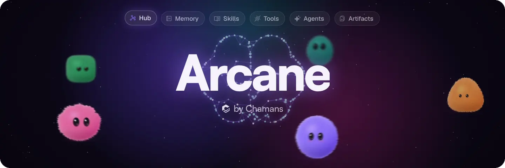
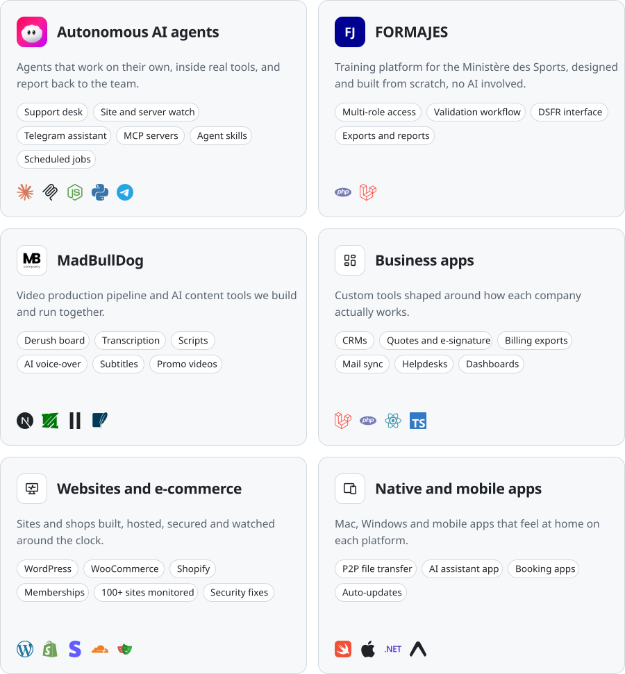
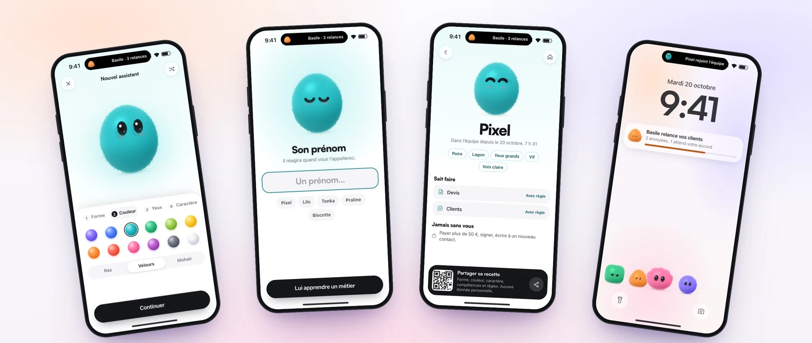
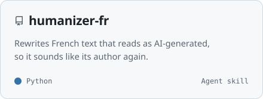
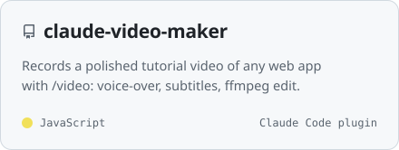
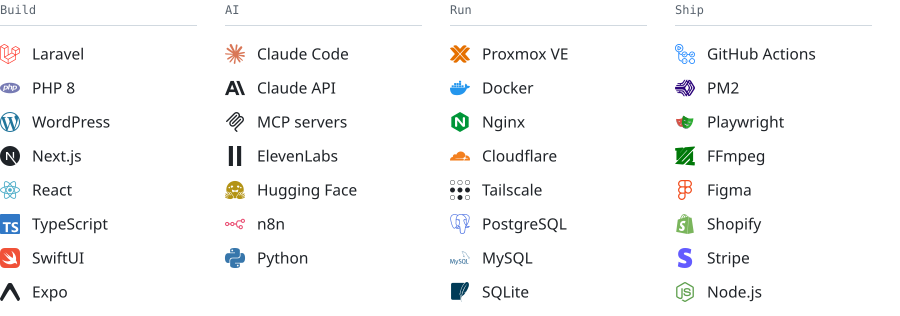

<picture>
  <source media="(prefers-color-scheme: dark)" srcset="assets/header-dark.svg">
  
</picture>

  <a href="https://weapzy.com"><picture><source media="(prefers-color-scheme: dark)" srcset="assets/link-weapzy-dark.svg"></picture></a>
  <a href="https://chamans.io"><picture><source media="(prefers-color-scheme: dark)" srcset="assets/link-chamans-dark.svg"></picture></a>
  <a href="https://shadowcoders.io"><picture><source media="(prefers-color-scheme: dark)" srcset="assets/link-shadowcoders-dark.svg"></picture></a>
  <a href="https://www.linkedin.com/in/thomas-laurent-var/"><picture><source media="(prefers-color-scheme: dark)" srcset="assets/link-linkedin-dark.svg"></picture></a>
  <a href="mailto:thomas@weapzy.com"><picture><source media="(prefers-color-scheme: dark)" srcset="assets/link-mail-dark.svg"></picture></a>

I'm an independent AI developer on the French Riviera. I design and ship web apps, autonomous AI agents and the infrastructure behind them. Right now I'm building Arcane with [Chamans](https://chamans.io), a sovereign AI ecosystem for teams, and I also work with [Weapzy](https://weapzy.com) and [Shadow Coders](https://shadowcoders.io).

### Work

<picture>
  <source media="(prefers-color-scheme: dark)" srcset="assets/work-dark.svg">
  
</picture>

### Apps

Apps should be a pleasure to open. Here, a mobile app where you design your own AI assistant, then teach it a job.

### Open source

  <a href="https://github.com/Thomaslrt/humanizer-fr"><picture><source media="(prefers-color-scheme: dark)" srcset="assets/repo-humanizer-fr-dark.svg"></picture></a>
  <a href="https://github.com/Thomaslrt/claude-video-maker"><picture><source media="(prefers-color-scheme: dark)" srcset="assets/repo-claude-video-maker-dark.svg"></picture></a>

### Toolbox

<picture>
  <source media="(prefers-color-scheme: dark)" srcset="assets/toolbox-dark.svg">
  
</picture>

### Activity

<picture>
  <source media="(prefers-color-scheme: dark)" srcset="assets/activity-dark.svg">
  
</picture>

 

on reste dans l'ombre, mais pas nos résultats
